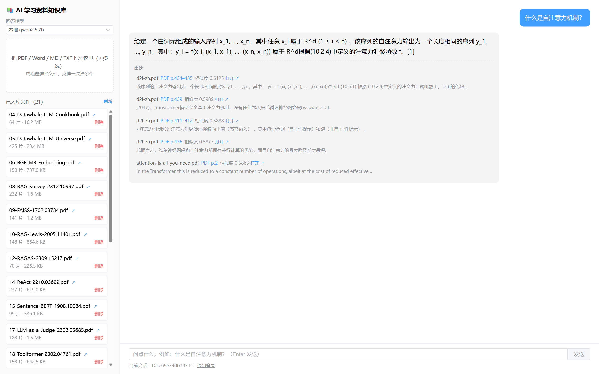
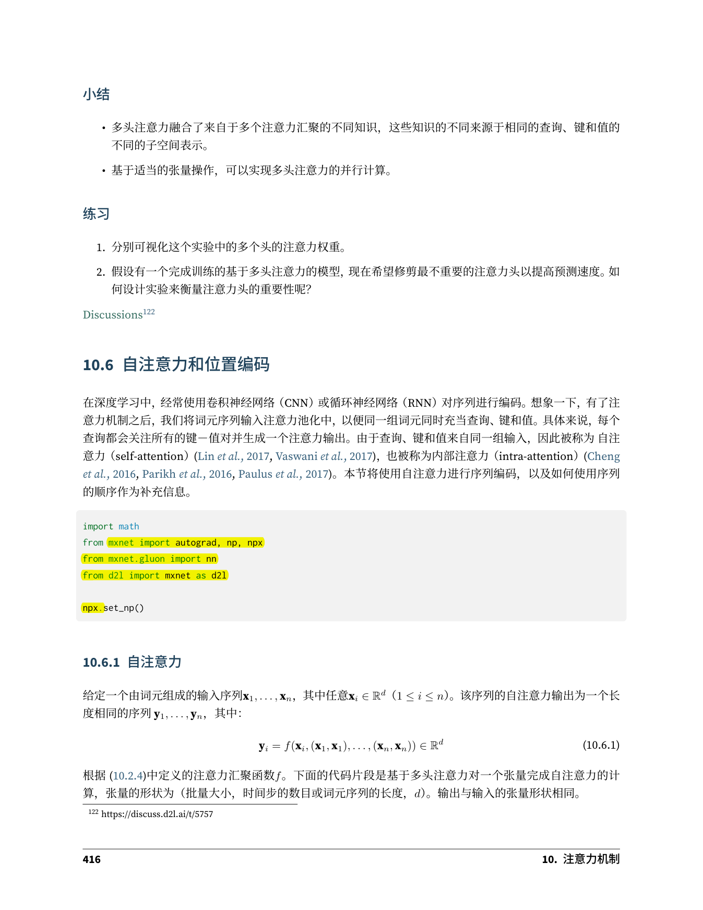

# AI 学习资料知识库

> 把 PDF / Word 学习资料变成可以追问的私人助教：**答案必须带出处，出处能一键翻到原书那一页并高亮。**

[](https://www.python.org/)
[](https://fastapi.tiangolo.com/)
[](https://vuejs.org/)
[](https://www.langchain.com/)
[](https://www.trychroma.com/)
[](https://ollama.com/)
[](LICENSE)



---

## 它解决什么问题

用通用助手问专业知识，最难受的两件事：**不知道答案从哪来**、**想核对时找不到原书哪一页**。

这个项目把 10 份 AI 教材和论文（《动手学深度学习》《语音与语言处理》《Attention Is All You Need》等）
切成 10,942 个片段存进向量库，回答问题时：

1. 先检索最相关的 5 个片段，过滤代码块、目录行等低价值碎片；
2. 只把其中 2 条塞给本地模型，控制上下文长度与延迟；
3. 答案里带 `[1]` 引用编号，下方列出**文件名 + 页码 + 相似度**；
4. 点开出处，后端在该页定位命中句、打黄色标注，直接跳到那一页；
5. 资料里确实没有的内容，明确说「资料中没有相关内容」，不编。



## 功能

| 模块 | 能力 |
|---|---|
| 入库 | PDF / DOCX / MD / TXT；多文件一次提交，后台任务 + 实时进度；单文件 100 MB 上限；空文件与不支持的类型在提交时即拒绝 |
| 检索 | bge-m3（1024 维）向量化，切片 512 / 重叠 50，Top-5 召回，过滤低价值碎片 |
| 回答 | 本地 `qwen2.5:7b` 或云端 `deepseek-chat` 可切换；流式输出（首字约 2.3 秒）；答案带引用编号 |
| 出处 | 文件名 + 页码（跨页给范围）+ 相似度 + 命中句；PDF 跳页高亮，DOCX 转网页阅读 |
| 会话 | 按会话 ID 存取历史，刷新不丢 |
| 安全 | 可选访问令牌（登录一次下发 7 天会话 Cookie）、按 IP 限流、路径穿越防护、容器内语料只读挂载 |
| 运维 | 日志落文件并轮转、上传任务落库（重启可查）、数据一键备份、Docker 一键启动 |

## 架构

```
┌──────────────┐   /api（Vite 代理 / Nginx 反代）
│  Vue3 + Vite │ ──────────────────────────────┐
│ Element Plus │                               │
└──────────────┘                               ▼
                                    ┌──────────────────────┐
                                    │   FastAPI (uvicorn)  │
                                    │  16 个 REST + SSE     │
                                    └───────────┬──────────┘
                    ┌───────────────────────────┼───────────────────────┐
                    ▼                           ▼                       ▼
          ┌──────────────────┐       ┌────────────────────┐   ┌──────────────────┐
          │ LangChain 检索链  │       │ Ollama / DeepSeek  │   │ SQLite           │
          │ 切片→向量→Top-5   │       │ qwen2.5:7b 生成     │   │ 会话与上传任务     │
          └────────┬─────────┘       │ bge-m3 向量化       │   └──────────────────┘
                   ▼                 └────────────────────┘
          ┌──────────────────┐
          │  ChromaDB 持久库  │  ai-kb-ai（AI 资料）/ ai-kb-ref（通用技术参考）
          └──────────────────┘
```

## 技术栈

| 层 | 选型 | 为什么 |
|---|---|---|
| 后端 | FastAPI + Pydantic + Uvicorn | 原生异步，SSE 流式简单，自带接口文档 |
| 前端 | Vue3 + Vite + Element Plus + axios | 组合式 API 上手快，组件库省掉造轮子 |
| 检索 | LangChain + ChromaDB | 切片、向量化、相似度检索一条链；Chroma 持久化零运维 |
| 模型 | Ollama（qwen2.5:7b、bge-m3）+ DeepSeek API | 本地免费可离线；云端保底，效果更好 |
| 存储 | SQLite | 单机场景够用，零部署成本 |
| 交付 | Docker + docker-compose + Nginx | 一条命令起全套 |

## 快速开始

### 前置

- Docker Desktop（或本地 Python 3.12 + Node 18+）
- [Ollama](https://ollama.com/download)，并拉模型：

```bash
ollama pull qwen2.5:7b
ollama pull bge-m3
```

### 方式一：Docker（推荐）

```bash
cp .env.example .env      # 按需改 AUTH_TOKEN / LLM_PROVIDER 等
docker compose up -d --build
```

打开 <http://localhost>。首次启动会预热模型，约 30 秒。

### 方式二：本地开发

```bash
python -m venv .venv && .venv\Scripts\activate     # Windows
pip install -r requirements.txt
copy .env.example .env

.venv\Scripts\python.exe -m app.main               # 后端 http://127.0.0.1:8000

cd web && npm install && npm run dev               # 前端 http://127.0.0.1:5173
```

把资料放进 `materials/`，在界面左上角拖进去即可入库。

## 评测

30 道题、每题标注期望出处（文件 + 页码），自动判分：

| 指标 | 结果 |
|---|---|
| 检索召回率（Top-5 命中期望页） | **90.0%**（27/30） |
| 答案准确率（覆盖度 + 模型双判） | **73.3%**（22/30） |
| 无关问题拒答 | **5/5** |
| 检索耗时（AI 专用库） | **0.31 s** |
| 问答热态整轮 | 5.7–6.2 s |
| 流式首字 | **2.34 s** |
| 入库速度 | 45–55 片段/秒（GPU） |
| 功能用例 | **30 / 30** |

复现：

```bash
.venv\Scripts\python.exe scripts\evaluate.py        # 30 题评测，输出 data/eval-results.csv
.venv\Scripts\python.exe tests\run_tests.py         # 30 个功能用例
```

做了 8 组对照实验（切片长度、重叠比例、上下文条数、本地 vs 云端、拒答提示词、PDF 解析器、重排），
**包括一组失败的实验**：用 7B 模型做列表式重排，Top-1 从 19 降到 13、检索慢 5 倍，结论是不采用。
数据在 [docs/experiments.md](docs/experiments.md)。

## 目录结构

```
app/                 后端：main（路由）/ rag（检索与生成）/ llm（模型封装）/ db（SQLite）/ config
web/                 前端：Vue3 + Vite，src/api.js 统一封装请求与 SSE 解析
scripts/             评测、实验、打包、备份、录屏等工具
tests/run_tests.py   30 个功能用例（入库、检索、问答、流式、拒答、出处）
docs/                计划书、技术栈、技术点详解、实验记录、基线、部署、评估报告
data/                运行期数据（向量库、SQLite、上传文件）——不入库
materials/           原始语料 PDF——不入库
```

## 关键设计取舍

- **切片 512 / 重叠 50**：256 太碎、1024 太糊，这是实验跑出来的。
- **只喂 2 条上下文**：3 条时模型被噪声带偏，延迟从 6.2 秒涨到 8 秒。
- **自写 Ollama 客户端**：LangChain 的 `OllamaEmbeddings` 会丢掉 `keep_alive`，
  导致每次请求重载模型（多等约 2 秒），换掉后解决。
- **高亮不缓存「未命中」结果**：早期把没找到句子的 PDF 也缓存了，后续永远不重新高亮。
- **上传改后台任务**：大文件同步入库会把请求卡住十分钟，改成任务 + 轮询进度。
- **重排实验失败就关掉**：指标全面变差，代码留在开关后面，默认关闭。

## 已知限制

- 单用户设计，没有多租户与配额；公网部署前请设 `AUTH_TOKEN` 并套 HTTPS（见 [docs/deploy.md](docs/deploy.md)）。
- 容器内生成比宿主机慢 2–4 倍（Docker Desktop 的 WSL2 限制，Linux 上不明显）。
- 6 GB 显存下向量模型与生成模型不能舒服地同时驻留，入库时会临时卸载对话模型。
- 页码高亮依赖文本匹配，扫描版 PDF（无文字层）无法定位。

## 文档

| 文档 | 内容 |
|---|---|
| [docs/技术栈说明.docx](docs/技术栈说明.docx) | 每个技术点的作用与选型理由 |
| [docs/技术点详解.docx](docs/技术点详解.docx) | 24 个技术细节的深入讲解 |
| [docs/experiments.md](docs/experiments.md) | 8 组对照实验数据（含失败结论） |
| [docs/baseline.md](docs/baseline.md) | 基线指标与错题分析 |
| [docs/acceptance.md](docs/acceptance.md) | 30 个任务的验收证据 |
| [docs/deploy.md](docs/deploy.md) | 内网穿透 / 云服务器两套部署方案 |
| [docs/项目评估报告-v2.docx](docs/项目评估报告-v2.docx) | 复评报告（含剩余风险） |

## License

[MIT](LICENSE)
