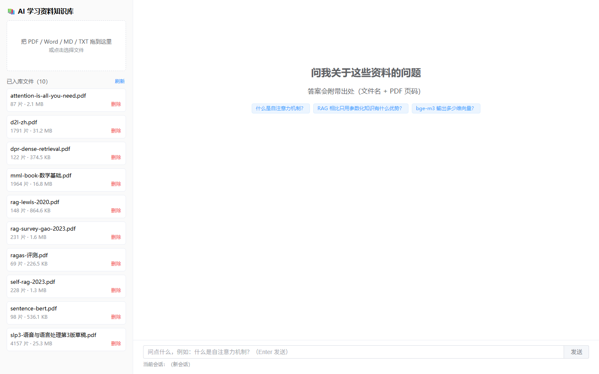
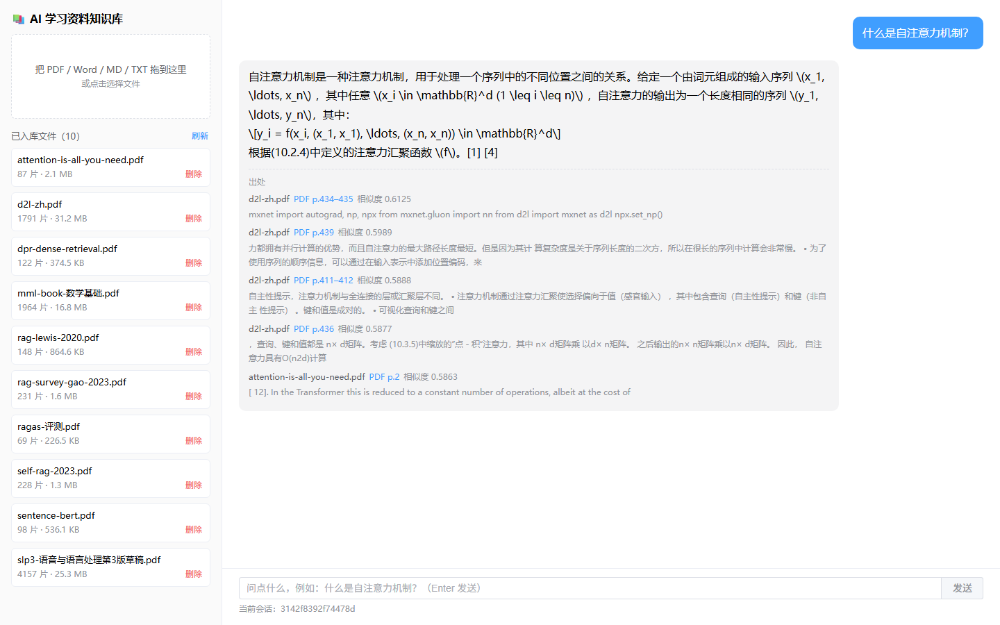
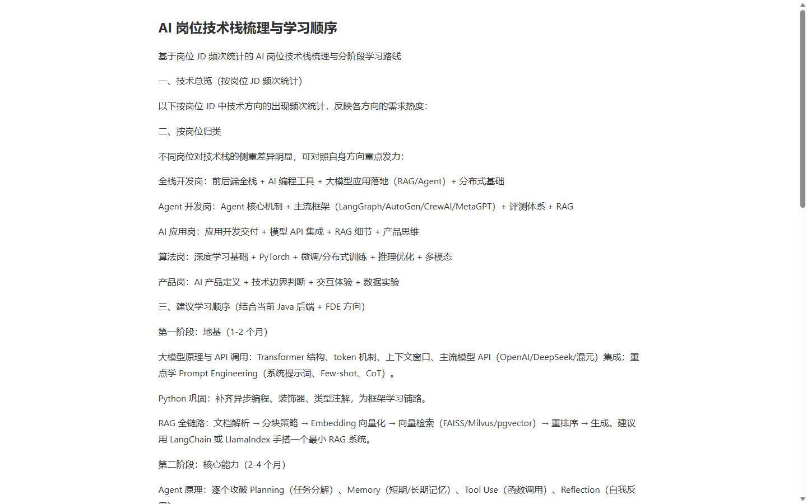
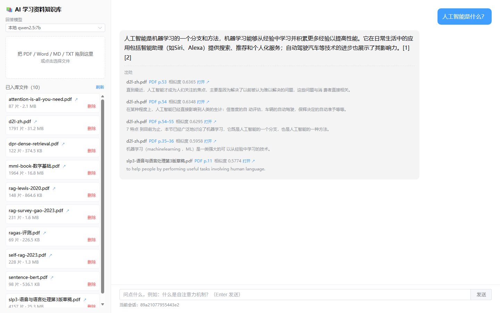
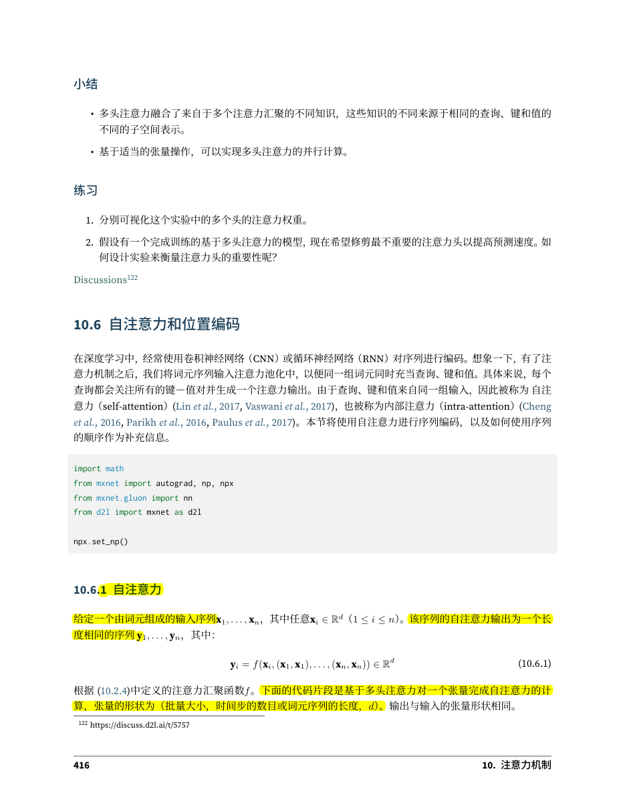

# AI 学习资料知识库（ai-kb）

把 AI 学习资料灌进向量库，提问后返回**带出处**的答案（文件名 + PDF 页码）。

- 单用户、无账号体系；支持 PDF / Word / Markdown / TXT
- 答案逐字流式输出，附「文件 + 页码 + 命中片段 + 相似度」
- 自建 30 题测试集评测：**检索召回率 90.0%**、**答案准确率 76.7%**

> 详细计划与进度见 [`docs/AI学习资料知识库-项目计划书.docx`](docs/AI学习资料知识库-项目计划书.docx)（v1.3）；
> 基线数据见 [`docs/baseline.md`](docs/baseline.md)。

## 界面





点开 DOCX 时的阅读视图（后端转 HTML，不弹下载）：



左侧是已入库资料（片数、大小、删除），右侧问答区给出答案与**出处卡片**（文件名 + PDF 页码 + 相似度 + 命中片段）。

每条出处展示四项信息：**文件名 · 页码 · 相似度 · 命中原文片段**。
片段不是机械截取前 100 字（那样会从单词中间断开），而是按句子切分后
用「与问题的字面重叠」挑出最相关的一句，并过滤掉代码行；超长在词边界截断加省略号。



**出处可以点开并高亮命中位置**：点任意一条出处，后端用 PyMuPDF 在该页搜索命中片段、
逐句按与问题的相关度排序，给最相关的句子加**黄色高亮**，再把整份 PDF 交给浏览器打开并跳到该页
（URL 形如 `/api/files/d2l-zh.pdf/highlight?page=434&q=...&question=...#page=434`）。


DOCX 浏览器渲染不了，由后端转成网页直接阅读（见截图）。

## 架构

```text
            ┌──────────────────────────────┐
 浏览器 ──▶ │ Vue3 + Element Plus (web/)   │  Vite 开发 / Nginx 托管
            └───────────────┬──────────────┘
                     /api 代理（SSE 不缓冲）
            ┌───────────────▼──────────────┐
            │ FastAPI（app/main.py）        │  /upload /chat /chat/stream /files
            ├──────────────────────────────┤
            │ RAG 核心（app/rag.py）        │  解析→切片→检索→拼 prompt→生成
            ├──────────────┬───────────────┤
            │ ChromaDB      │ SQLite        │  向量库 data/chroma · 会话 data/app.db
            │ (bge-m3)      │ (历史)        │
            └──────────────┴───────┬───────┘
                                    │ HTTP
                          ┌─────────▼─────────┐
                          │ Ollama（宿主机）    │  bge-m3（向量）+ qwen2.5:7b（生成）
                          └───────────────────┘
```

模型层可切换：`LLM_PROVIDER=ollama`（本地免费）或 `deepseek`（云端，需 API Key），
业务代码不硬编码模型名，见 `app/llm.py`。

## 快速开始（本地）

### 方式一：双击启动（推荐）

双击项目根目录的 **`start.bat`** —— 它会依次检查 Ollama、启动后端、启动前端，全部就绪后自动打开浏览器。
关闭服务双击 **`stop.bat`**（Ollama 保持运行，下次更快）。

### 方式二：手动起三条命令

```powershell
# 1) 依赖
py -3.12 -m venv .venv
.\.venv\Scripts\python.exe -m pip install -r requirements.txt

# 2) 配置（按需改 .env：模型名、端口、闸门阈值）
Copy-Item .env.example .env

# 3) 起服务
.\.venv\Scripts\python.exe -m app.main          # http://127.0.0.1:8000/docs
.\.venv\Scripts\python.exe -m streamlit run ui_streamlit.py   # 临时界面 http://localhost:8501

# 4) 产品界面（Vue3）
cd web; npm install --registry=https://registry.npmmirror.com; npm run dev   # http://127.0.0.1:5173
```

前置条件：本机装好 [Ollama](https://ollama.com/) 并拉取模型：

```powershell
ollama pull bge-m3
ollama pull qwen2.5:7b
```

首次使用需要把资料入库（把 PDF 放进 `materials/`）：

```powershell
.\.venv\Scripts\python.exe scripts\04_store.py --all    # 全量入库（约 8,900 片，视机器 40-60 分钟）
```

## Docker（可选）

```powershell
docker compose up -d --build      # 前端 http://localhost  后端 http://localhost:8000
docker compose logs -f backend    # 看日志
docker compose down               # 停止
```

**实测结果（本机 Docker Desktop 29.9.2）**

| 项 | 结果 |
|---|---|
| 后端镜像 | 1.29 GB，容器状态 healthy |
| 前端镜像 | Nginx 托管，80 端口返回 200 |
| 向量库 | 挂载 `./data`，容器内读到 8,895 条；重启容器后仍在 |
| 接口 | 经 Nginx 反代上传 / 问答 / 流式 / 删除全部通过 |
| PDF 高亮 | 容器内 PyMuPDF 正常（8 个注释，1.2s） |

**两个必需的处理**

1. **国内拉不到 Docker Hub**：基础镜像可用镜像站覆盖

   ```powershell
   $env:BASE_IMAGE="docker.m.daocloud.io/library/python:3.12-slim"
   $env:NODE_IMAGE="docker.m.daocloud.io/library/node:24-alpine"
   $env:NGINX_IMAGE="docker.m.daocloud.io/library/nginx:1.27-alpine"
   docker compose build
   ```

2. **镜像依赖做了精简**（`requirements-docker.txt`）：去掉 torch / sentence-transformers /
   transformers / streamlit 及其依赖。原因：embedding 走 Ollama，代码里没有任何相关 import，
   而 `sentence-transformers` 会强制拉 554 MB 的 torch。镜像因此从预计 4 GB+ 降到 1.29 GB。

**已知差异**：容器内问答约 13–22 秒，比本机（3–5 秒）慢 2–4 倍。检索只占 0.24 秒，
慢在生成——Docker Desktop 的 WSL2 虚拟机会和宿主机抢 CPU。真实 Linux 服务器上不会有这个问题。

## 配置（`.env`）

| 键 | 默认 | 说明 |
|---|---|---|
| `LLM_PROVIDER` | `ollama` | `ollama` 或 `deepseek` |
| `OLLAMA_MODEL` | `qwen2.5:7b` | 生成模型 |
| `OLLAMA_EMBED_MODEL` | `bge-m3:latest` | 向量模型（1024 维） |
| `OLLAMA_BASE_URL` | `http://localhost:11434` | Ollama 地址 |
| `DEEPSEEK_API_KEY` | 空 | 切云端时才需要 |
| `CHUNK_SIZE` / `CHUNK_OVERLAP` | 512 / 50 | 切片参数 |
| `TOP_K` | 5 | 检索条数 |
| `RAG_SCORE_GATE` | 0.45 | 最佳相似度低于此值直接答「资料中没有相关内容」 |
| `APP_PORT` | 8000 | 服务端口 |

`.env` 不进 Git，模板见 `.env.example`。

## 接口

| 方法 | 路径 | 说明 |
|---|---|---|
| GET | `/health` | 健康检查（返回库里条数与当前模型） |
| POST | `/upload` | 上传文件 → 解析/切片/嵌入/入库，返回 `filename/chunks/size` |
| POST | `/chat` | 问答，返回 `answer/sources/session_id` |
| POST | `/chat/stream` | SSE 流式：`sources → token… → done` |
| GET | `/files` | 已入库文件（文件名、大小、切片数） |
| DELETE | `/files/{name}` | 删除文件及其向量 |
| GET | `/sessions/{id}` | 按会话 ID 取回历史 |
| GET | `/providers` | 可选模型列表（供界面下拉框） |
| GET | `/files/{name}/raw` | PDF/MD/TXT 内嵌打开（PDF 支持 `#page=N` 跳页） |
| GET | `/files/{name}/view` | DOCX 转成 HTML 页面，浏览器内直接阅读（不下载） |
| GET | `/files/{name}/highlight` | PDF 在命中句子处打黄色高亮后返回（`page`/`q`/`question`） |

## 换设备 / 迁移

**会自动连接新设备的本地模型，但不会自动"发现"模型名。** 具体：

| 项 | 行为 |
|---|---|
| Ollama 地址 | `.env` 里 `OLLAMA_BASE_URL=http://127.0.0.1:11434`，指本机 → 换设备自动跟随 |
| 生成模型 | `.env` 里的只是**默认值**；界面上会自动列出本机所有已下载模型供选择，换设备后无需改配置 |
| 向量模型 | 写死在 `.env`（`bge-m3:latest`）—— 换它会破坏 1024 维索引，因此不给选 |
| 项目路径 | 全部相对项目根（`config.py` 用 `Path(__file__).parent.parent`）→ 换盘符/目录都不用改 |
| 向量库 | 与 `bge-m3` 的 1024 维绑定 → **换 embedding 模型必须重建索引**；只换设备沿用同一模型则无影响 |

迁移步骤：

```powershell
# 1) 新设备装 Ollama 并拉模型
ollama pull qwen2.5:7b
ollama pull bge-m3

# 2) 拷项目（用完整包可连向量库和语料一起带走）
# 3) 一键自检，缺什么它会直接告诉你
.venv\Scripts\python.exe scripts\check_env.py
```

`start.bat` 启动前会自动跑这个自检；不通过会列明补法（例如 `ollama pull xxx`）并询问是否继续。

## 打包分发

```powershell
.venv\Scripts\python.exe scripts\package.py
```

产物在 `dist/ai-kb-src-YYYYMMDD.zip`（约 0.7 MB、59 个文件）。
包含：代码、脚本、前端源码、文档、测试集与评测结果、启动脚本、`.env.example`。
**不含**：`.venv`、`node_modules`、向量库、语料、上传文件、`.env`
（脚本内置检查，发现 `.env` 会直接拒绝打包）。

要「解压即用」（含 8,895 条向量库与 10 份语料）就打完整包：

```powershell
.venv\Scripts\python.exe scripts\package.py --full
```

产物 `dist/ai-kb-full-YYYYMMDD.zip`（约 378 MB）。解压后只需装依赖即可直接启动，
不用重新入库（省约 48 分钟）；注意语料有版权，适合自己备份/迁移，不宜公开分发。

拿到包的人解压后按「快速开始」重建环境即可。

## 项目结构

```text
app/            config.py 配置 · llm.py 模型抽象 · rag.py RAG 核心 · db.py 历史 · main.py 路由
scripts/        01 提取 · 02 切片 · 03 向量验证 · 04 入库 · 05 命令行 RAG · 06 测试集 · evaluate.py 评测
web/            Vue3 前端（src/views/Chat.vue 主界面）
materials/      10 份 AI 学习资料 PDF（不进 Git）
data/           chroma/ 向量库 · app.db 历史 · uploads/ 上传文件 · testset.csv 测试集
docs/           计划书、基线、环境记录
```

## 自动化测试

```powershell
.venv\Scripts\python.exe tests\run_tests.py
```

30 个用例，分四组（脚本自己拉起后端，跑完自动关闭）：

| 组 | 内容 |
|---|---|
| A 接口契约（10） | health / providers / files / upload / delete 的返回结构与错误码 |
| B 安全与边界（6） | 路径穿越、未知文件、空问题、超长问题、docx 阅读视图、PDF 高亮 |
| C 问答与流式（6） | 答案与出处、无关问题拒答、会话落库、SSE 事件顺序、指定模型 |
| D 纯函数与数据（8） | clean_answer、best_snippet、page_label、测试集与评测结果一致性 |

当前结果：**30/30 通过**（约 70 秒）。

### 入库性能（2026-10-23 优化）

上传后的「解析 → 切片 → 向量化 → 入库」做过两处优化，实测：

| 场景 | 优化前 | 优化后 | 提升 |
|---|---|---|---|
| 向量化速率 | 3.4 片/秒（CPU） | **45–55 片/秒（GPU）** | 约 13–16 倍 |
| 148 片 PDF 上传 | 约 45 秒 | **6.3 秒** | 约 7 倍 |
| 813 页 / 1791 片 PDF | 约 9.5 分钟 | **约 45 秒** | 约 13 倍 |
| 解析（813 页） | 42.5 秒（pypdf） | **1.4 秒（PyMuPDF）** | 约 30 倍 |

做法：
1. **入库时把向量模型放 GPU**：入库不需要生成模型，先卸载聊天模型腾出显存，
   再用 `num_gpu=-1` 加载 bge-m3，完成后把显存还给生成模型（`INGEST_USE_GPU=1`）。
2. **PDF 改用 PyMuPDF 解析**：字数与 pypdf 差 0.7%，召回率同为 90.0%（`PDF_EXTRACTOR=fitz`，
   出问题自动退回 pypdf）。

注意：如果机器上还有别的程序在调 Ollama，显存会被抢占，入库会退回 CPU 速率。
实测过一次 148 片跑了 48 秒，就是被另一个项目占着模型所致。

## 评测

```powershell
.\.venv\Scripts\python.exe scripts\evaluate.py
```

30 题覆盖 10 份资料，指标定义与错题分析见 `docs/baseline.md`。当前基线：

| 指标 | 目标 | 实测 |
|---|---|---|
| 检索召回率 | ≥ 80% | **90.0%** |
| 答案准确率 | ≥ 70% | **76.7%** |
| 首字延迟 / 完整耗时 | ≤ 3s / ≤ 15s | **1.2s / 均值 3.6s** |
| 云端对照（deepseek-chat） | — | 召回 90.0% · 准确 **86.7%** · 1.1s |

## 几个值得说的技术点

1. **切片的 50 字重叠是补出来的**：LangChain 的 `chunk_overlap` 按切分单元整块回退，
   PDF 长行会让重叠变成 0。本项目切完后再做边界补齐，保证「≤512 字且相邻重叠 ≥50」。
2. **「资料中没有」用双保险**：相似度闸门（0.45）+ prompt 约束。单纯靠阈值不可靠 ——
   实测无关文本对的余弦也能到 0.35。
3. **bge-m3 的 NaN 兜底**：Ollama 版模型对个别 token 会返回 500，已在 Embedding 层加
   降级重试，避免一句坏输入让整次检索失败。
4. **出处不撒谎**：跨页切片同时记录 `page_start/page_end`，回答里写 `p.434–435`；
   d2l-zh 的印刷页码 = 物理页 − 18，文档如实标注是 PDF 物理页。

## 当前进度

- ✅ M0 环境 · M1 命令行 RAG · M2 后端 API · M3 前端（Vue3 可跑，代理/SSE 已验） · M4 测试集与基线
- 🟡 M5 交付：Docker 文件就绪但本机无 Docker、演示视频待录
- 🟡 M6 加分：A/B 实验 E1/E4 已出数据；E2/E3 需额外拉模型；云部署待定方案
- ⚠️ 首字延迟未达 ≤3s：6GB 显存跑本地 7B 模型，实测热态 3.5–6s，详见 `docs/baseline.md` 第 8 节

## 已知限制

- 单用户设计，无鉴权（计划书明确不做用户系统）
- 目录页/参考文献页仍会进入向量库（检索侧已过滤大部分）
- 本地 7B 模型在长答案上偶有细节偏差，基线文档里逐条记录了错题
